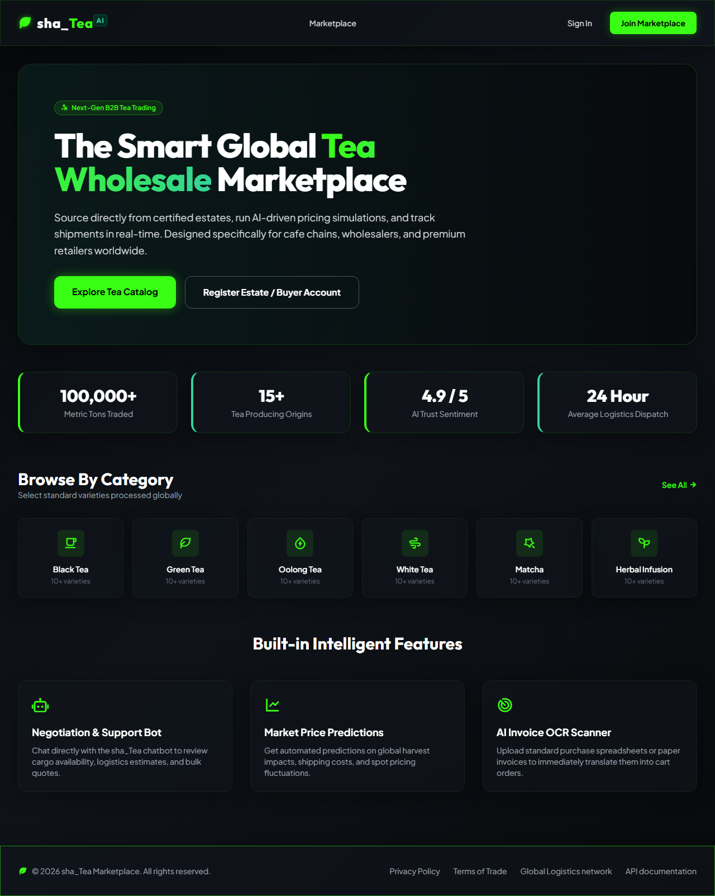
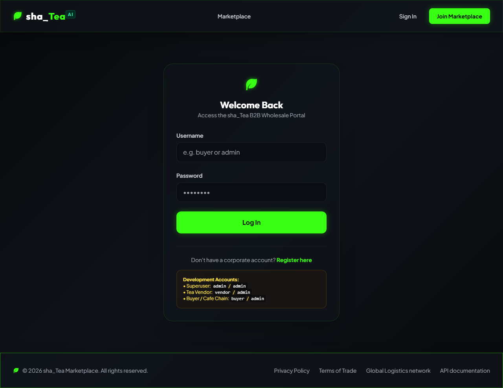
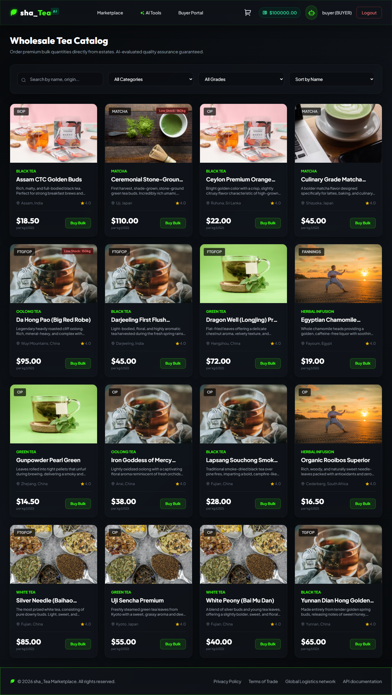
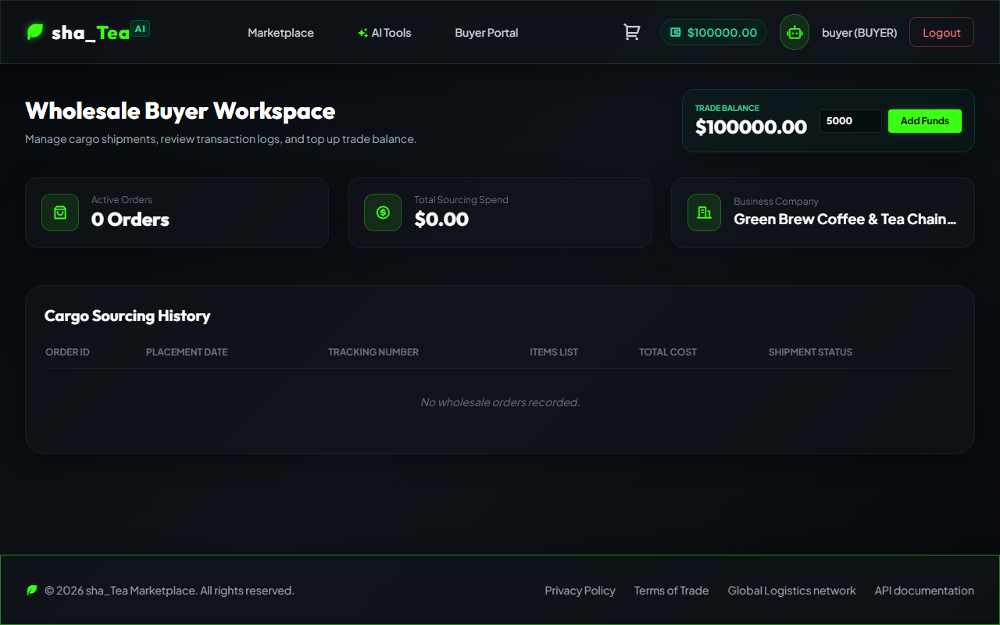
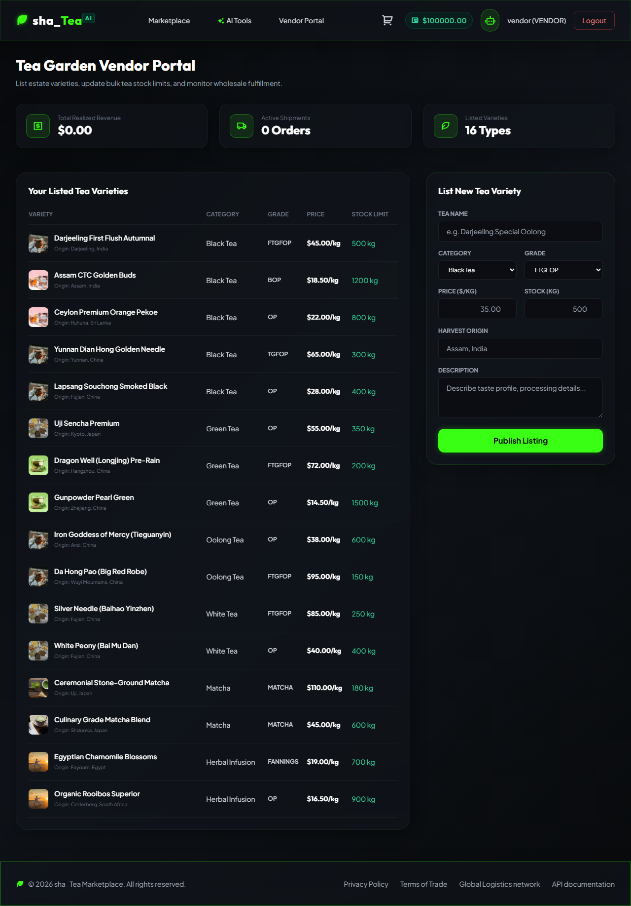
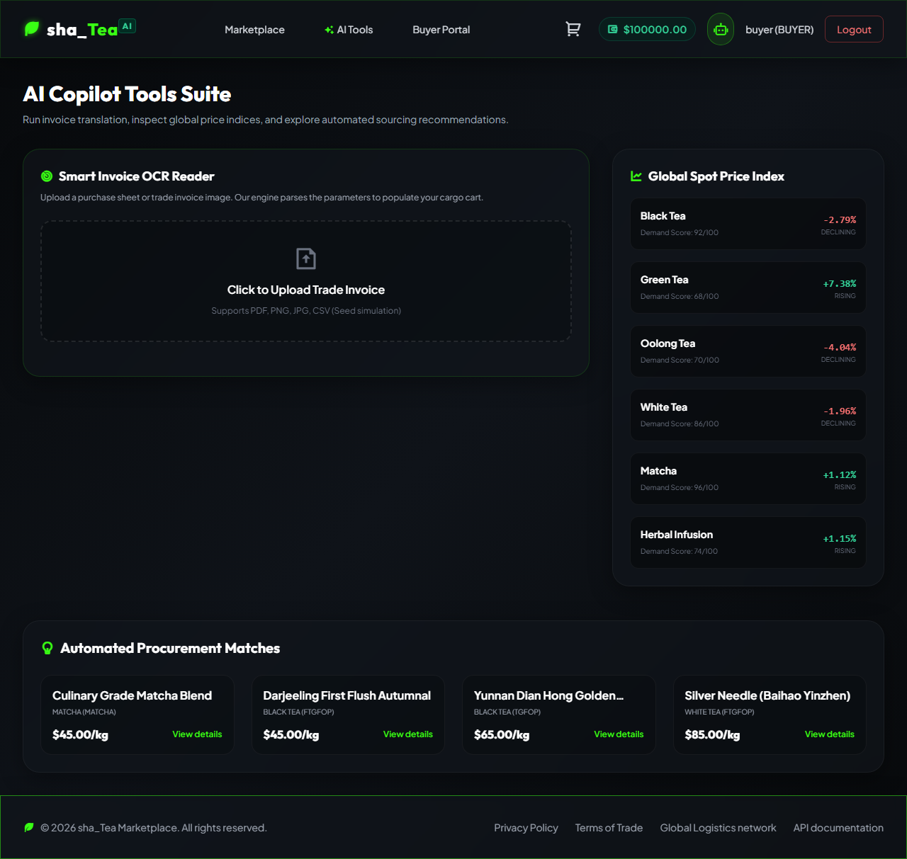
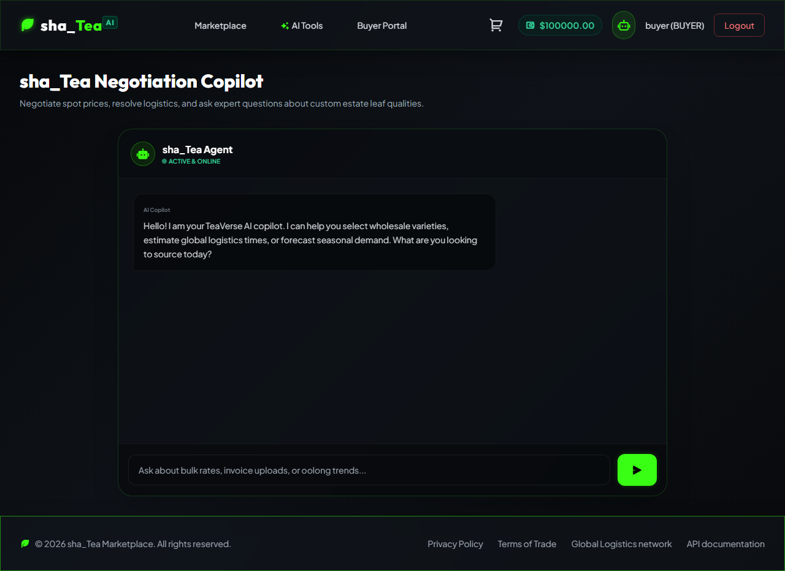
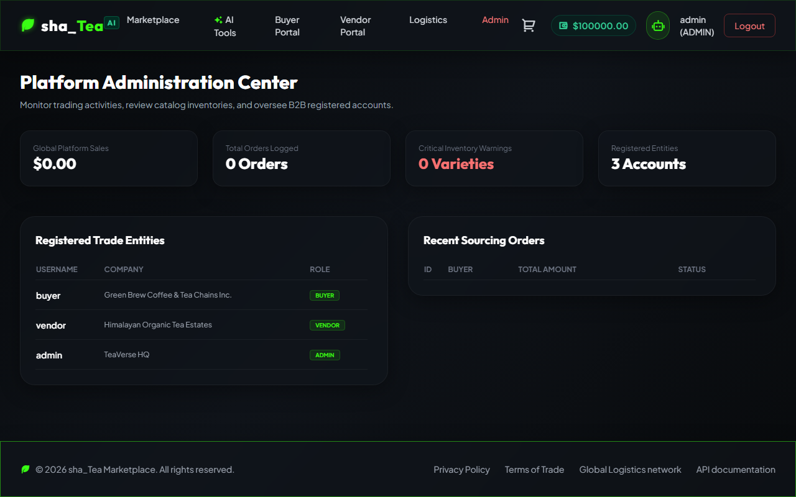

# sha_Tea - Smart Tea Wholesale Marketplace

Welcome to the **sha_Tea** B2B Wholesale Marketplace! This is an enterprise-scale Python Django web application featuring a stunning premium dark-mode glassmorphism UI with neon-green accents, tailored for the global tea trade.

## Key Features
- **Multi-Role Portals:** Dedicated dashboards for Wholesale Buyers, Tea Estate Vendors, and Administrators.
- **AI Negotiation Copilot:** A built-in chatbot for market price inquiries and logistics estimates.
- **AI Tools Suite:** Automated procurement matching and intelligent invoice OCR.
- **Wholesale Catalog:** Filter by category, grade, and bulk pricing.
- **Wallet & Checkout:** Secure digital trade wallet for seamless bulk transactions.

## Gallery

### 1. Landing Page (Home)

### 2. Login Page

### 3. Wholesale Tea Catalog

### 4. Buyer Dashboard

### 5. Vendor (Tea Estate) Portal

### 6. AI Copilot Tools Suite

### 7. AI Negotiation Chatbot

### 8. Platform Administration

## Tech Stack
- **Backend:** Python, Django
- **Frontend:** HTML, Tailwind CSS, Custom UI Tokens
- **Database:** SQLite (Development)

## Setup Instructions
1. Clone the repository: `git clone https://github.com/kakkarot23/Sha_Tea_Verse.git`
2. Install dependencies: `pip install -r requirements.txt`
3. Run migrations: `python manage.py migrate`
4. Seed the database with mock data: `python manage.py seed_tea`
5. Start the server: `python manage.py runserver`
